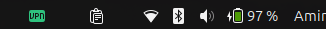
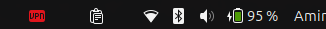

# OpenFortiVPN Status Indicator

[](https://gitlab.gnome.org/GNOME/gnome-shell)
[](LICENSE)

Minimal, lightweight, and read-only GNOME Shell panel indicator for your OpenFortiVPN sessions.

| Connected | Disconnected |
| :---: | :---: |
|  |  |

---

## How It Works

The extension runs in user-space with zero elevated privileges and checks the connection state every 3 seconds:

1. **Process Detection**: Verifies that the `openfortivpn` daemon is actively running via `pgrep`.
2. **Tunnel Interface Detection**: Verifies the presence of the virtual network interface via `/sys/class/net/ppp0`.
3. **Visual Feedback**:
   - 🟢 **Green**: Both process and interface are present (VPN fully connected).
   - 🔴 **Red**: One or both checks fail (VPN disconnected).

> [!NOTE]
> It is strictly read-only: it does not manage credentials, alter network routing tables, or start/stop the VPN session. Your existing connection workflow remains completely unchanged.

---

## Quick Install

Pack and install using the official GNOME extensions CLI:

```bash
git clone https://github.com/aminelch/openfortivpn-indicator.git
cd openfortivpn-indicator
gnome-extensions pack --force
gnome-extensions install --force *.shell-extension.zip
gnome-extensions enable openfortivpn-indicator@aminelch.github.io
```

*Note: On GNOME Shell, you may need to log out and log back in once for the extension to register.*

### Uninstall

```bash
gnome-extensions disable openfortivpn-indicator@aminelch.github.io
rm -rf ~/.local/share/gnome-shell/extensions/openfortivpn-indicator@aminelch.github.io
```

---

## Contributing

Contributions and feedback are welcome! Please check [CONTRIBUTING.md](CONTRIBUTING.md) for testing guidelines and pull request instructions.

---

## License

This project is licensed under the [GNU General Public License v3.0 or later (GPL-3.0-or-later)](LICENSE).
